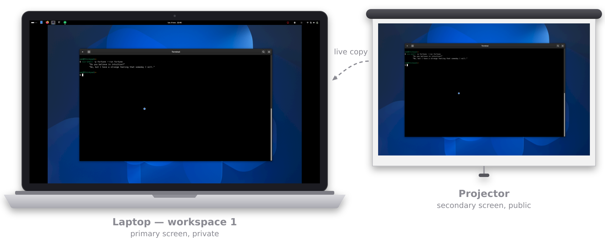
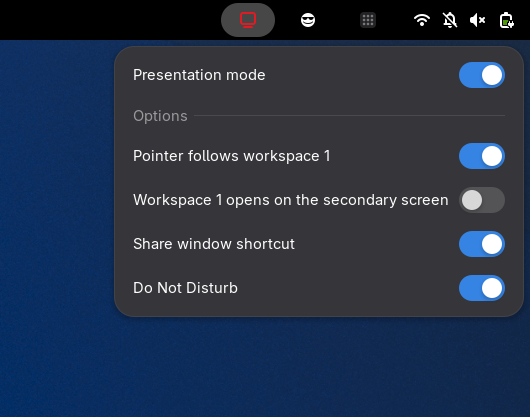

<div align="center">

# 📽️ Presentation workspace

**Present on the second screen. See what the room sees. Keep the rest private.**

*No OBS. No screen capture. A GNOME Shell extension that turns workspace 1 into a live
view of the screen behind you.*

[](https://github.com/essembeh/gnome-presentation-workspace/actions/workflows/build.yml)
[](https://release.gnome.org/)
[](LICENSE)

</div>

---

You give a training. Your laptop drives a projector in **extended** mode: what you put
on the projector, the room sees; your laptop screen keeps your notes, your mail, your
private stuff. Only the projector is **behind you** — so you end up turning around, or
running an OBS projector window just to see what you are showing.

This extension replaces that OBS window: workspace 1 of your screen shows a live copy
of the projected one, workspaces 2, 3… stay private.



## What it does

- 📽️ **One button in the top bar.** Red while presenting, plain otherwise. Click it
  for a menu: the mode switch and a handful of options. You are not always
  presenting — the mode is off at every login and turns on in one click.
- 🪞 **Workspace 1 is the room's view.** A live copy of the secondary screen, scaled
  to fit with black bands, drawn under your top bar. Leave workspace 1 and it is
  gone; come back and it is there. It is a compositor clone, not a video capture:
  no lag, no encoding, near-zero cost.
- 🔴 **You see the pointer.** A dot marks where the pointer is on the secondary
  screen — on a scaled-down copy, a real arrow would be lost.
- 🧹 **Workspace 1 holds nothing else.** Turn the mode on with windows already there:
  an empty workspace is inserted in front of them and becomes workspace 1. Your
  windows slide one workspace to the right, untouched.
- 🎞️ **Fullscreen slides keep moving.** A fullscreen window on the secondary screen
  normally bypasses the compositor and would freeze the copy; not while presenting.
- ⌨️ **`Super+Shift+P` shares the focused window** — sends it to the secondary screen,
  or brings it back to the workspace it came from.
- 🔕 **Do Not Disturb while presenting**, and your previous setting back afterwards —
  even if GNOME Shell crashes in between.



## The menu

| Entry                                     | What it does                                                      | Default |
| ----------------------------------------- | ----------------------------------------------------------------- | ------- |
| Presentation mode                         | the mode itself; greyed out without a secondary screen            | off     |
| Pointer follows workspace 1               | entering workspace 1 jumps the pointer to the secondary screen    | off     |
| Workspace 1 opens on the secondary screen | a window opened or moved to workspace 1 goes to the public screen | off     |
| Share window shortcut                     | enables `Super+Shift+P`                                           | on      |
| Do Not Disturb                            | mutes notification banners while presenting                       | on      |

The options switch a behavior on or off; they do not tune it. Toggling one keeps the
menu open.

**Pointer follows workspace 1** — moving from one screen to the other means dragging
the pointer across the edge. With this on, arriving on workspace 1 (trackpad gesture,
scroll on the top bar, shortcut) puts the pointer in the middle of the secondary
screen, and leaving workspace 1 brings it back to the middle of the primary one — only
if it was still on the secondary screen. Switching between private workspaces never
moves it.

**Workspace 1 opens on the secondary screen** — workspace 1 *shows* the public screen,
so launching an app from there means you want to show it. With this on, the window
lands on the secondary screen instead of hiding under the copy. Windows that were on
workspace 1 before the mode turned on are never shown to the room: they moved to
workspace 2.

**The shortcut** — `Super+Shift+P` on a window of the primary screen sends it to the
secondary screen; on a window of the secondary screen, brings it back to the workspace
it came from and switches there (never to workspace 1 while presenting). It works
whether the mode is on or not. GNOME already has `Super+Shift+←/→`; this one needs no
thinking about which side the screen is on. To change the key:

```bash
gsettings --schemadir ~/.local/share/gnome-shell/extensions/presentation-workspace@essembeh.org/schemas \
  set org.gnome.shell.extensions.presentation-workspace share-window "['<Super><Shift>o']"
```

## Which screen is which

The extension assumes nothing about your hardware. The **private** screen is the one
GNOME calls **primary** (Settings › Displays › Primary Display); the **public** one is
the first other screen. Laptop + projector is the usual case, but a desktop with two
monitors works the same way.

## What it deliberately does NOT do

No clicking through the copy: it is read-only, the room's screen is driven from the
room's screen. No floating thumbnail, no picture-in-picture, no third screen. No
resolution switching — GNOME's Settings › Displays does it already. No presenter
timer, no laser pointer, no annotations.

Small code, few settings: see [the spec](docs/specs/features.md) (in French) — §0
(KISS) is the project's constitution, §3 lists what stays out.

## Requirements

| Setting                                       | Expected                                    |
| --------------------------------------------- | ------------------------------------------- |
| GNOME Shell                                   | 50                                          |
| Settings › Displays › Multiple Displays       | **Join** (extended), not Mirror             |
| Settings › Displays › Primary Display         | your **private** screen                     |
| `org.gnome.mutter workspaces-only-on-primary` | `true` (the default)                        |
| Settings › Multitasking › Workspaces          | **dynamic** (to insert the empty workspace) |

With `workspaces-only-on-primary` off, the secondary screen changes with the
workspace and the whole idea falls apart. With fixed workspaces everything works,
except that windows already on workspace 1 stay hidden under the copy instead of
moving to workspace 2.

## Install

### From a release

```bash
curl -L -o /tmp/presentation-workspace.zip \
  "https://github.com/essembeh/gnome-presentation-workspace/releases/latest/download/presentation-workspace@essembeh.org.shell-extension.zip"
gnome-extensions install --force /tmp/presentation-workspace.zip
```

Log out and back in (Wayland gives no other way to load new extension code), then:

```bash
gnome-extensions enable presentation-workspace@essembeh.org
```

### From source

```bash
git clone https://github.com/essembeh/gnome-presentation-workspace.git
cd gnome-presentation-workspace
just install    # checks, builds the zip, installs it
```

Then log out and back in, and enable it as above.

## Hacking

Dev tools come from [`shell.nix`](shell.nix) (`node`, `glib-compile-schemas`, `zip`,
`just`), loaded automatically by direnv (`direnv allow` once).

```bash
just            # list the recipes
just check      # what the CI runs: syntax, unit tests, markdown tables, schema
just install    # build the zip and install it in your session
```

There is no nested shell: a nested GNOME Shell cannot display two monitors, so the
extension is tested in a real session with a real second screen. Pure logic
(letterboxing, pointer and workspace decisions) lives in `src/geometry.js`, free of
`gi://` imports, and is unit-tested under node.

## License

[GPL-3.0](LICENSE) — same as GNOME Shell itself.
