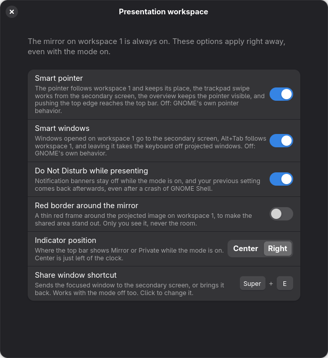

<div align="center">

# 📽️ Presentation workspace

**Present on the second screen. See what the room sees. Keep the rest private.**

*No OBS. No screen capture. A GNOME Shell extension that turns workspace 1 into a live
view of the screen behind you.*

[](https://github.com/essembeh/gnome-presentation-workspace/actions/workflows/build.yml)
[](https://release.gnome.org/)
[](LICENSE)

</div>

---

You give a training. Your laptop drives a projector in **extended** mode: what you put
on the projector, the room sees; your laptop screen keeps your notes, your mail, your
private stuff. Only the projector is **behind you** — so you end up turning around, or
running an OBS projector window just to see what you are showing.

This extension replaces that OBS window: workspace 1 of your screen shows a live copy
of the projected one, workspaces 2, 3… stay private.


## What it does

- 📽️ **One button in Quick Settings**, next to Wi-Fi and Do Not Disturb, with the
  preferences one click away. While presenting, the top bar shows a red **Mirror** on
  workspace 1 and a green **Private** on the others; otherwise the extension adds
  nothing there. Private is about the workspace you are on: the room still sees the
  secondary screen. The mode is off at every login and turns on in one click.
- 🪞 **Workspace 1 is the room's view.** A live copy of the secondary screen, scaled
  to fit with black bands, drawn under your top bar. Leave workspace 1 and it is
  gone; come back and it is there. It is a compositor clone, not a video capture:
  no lag, no encoding, near-zero cost.
- 🔴 **You see the pointer.** A dot marks where the pointer is on the secondary
  screen — on a scaled-down copy, a real arrow would be lost.
- 🔭 **The overview shows it too.** In the overview, workspace 1 lists the projected
  windows instead of looking empty; click one to go back to it.
- 🧹 **Workspace 1 holds nothing else.** Turn the mode on with windows already there:
  an empty workspace is inserted in front of them and becomes workspace 1. Your
  windows slide one workspace to the right, untouched.
- 🎞️ **Fullscreen slides keep moving.** A fullscreen window on the secondary screen
  normally bypasses the compositor and would freeze the copy; not while presenting.
- ⌨️ **`Super+E` shares the focused window** — sends it to the secondary screen,
  or brings it back to the workspace it came from. The key can be changed.
- ⬆️ **Push the top edge to reach the top bar.** On workspace 1, push the pointer
  against the top of the secondary screen: it lands on your top bar, right above its
  place in the copy. Go back down and it returns to the secondary screen.
- 🔀 **Alt+Tab follows workspace 1.** On workspace 1 it lists the windows the room
  sees, not your private ones; from a private workspace, picking a projected window
  takes you back to workspace 1.
- 🔕 **Do Not Disturb while presenting**, and your previous setting back afterwards —
  even if GNOME Shell crashes in between.

## Menu and preferences

The **Presentation** button sits in GNOME's Quick Settings menu, top right. Click it to
turn the mode on or off (greyed out without a secondary screen); its arrow opens a
menu with **Preferences**. The preferences window also opens from GNOME's Extensions
app, like any extension's.
Options are grouped by theme, each with a line explaining it, and apply right away,
even with the mode on.

<p align="center"></p>

| Group         | Option                                    | Default   |
| ------------- | ----------------------------------------- | --------- |
| Pointer       | Pointer and keyboard follow workspace 1   | off       |
| Pointer       | Push the top edge to reach the top bar    | on        |
| Windows       | Workspace 1 opens on the secondary screen | off       |
| Windows       | Share window shortcut                     | on        |
| Windows       | Shortcut                                  | `Super+E` |
| Alt+Tab       | Alt+Tab follows workspace 1               | on        |
| Notifications | Do Not Disturb while presenting           | on        |

The options switch a behavior on or off; they do not tune it — the shortcut's key is
the one exception.

**Pointer and keyboard follow workspace 1** — moving from one screen to the other means
dragging the pointer across the edge. With this on, arriving on workspace 1 (trackpad
gesture, scroll on the top bar, shortcut) puts the pointer on the secondary screen, at
the spot it was over in the copy. Leaving workspace 1 brings it back to that spot on the
primary screen — only if it was still on the secondary one. Leaving also takes the
keyboard off a projected window, so what you type next stays private. Switching between
private workspaces never moves them.

The trackpad gesture switches workspaces from the secondary screen too while the mode is
on, whatever this option says.

**Workspace 1 opens on the secondary screen** — workspace 1 *shows* the public screen,
so launching an app from there means you want to show it. With this on, the window
lands on the secondary screen instead of hiding under the copy. Windows that were on
workspace 1 before the mode turned on are never shown to the room: they moved to
workspace 2.

**The shortcut** — `Super+E` on a window of the primary screen sends it to the
secondary screen; on a window of the secondary screen, brings it back to the workspace
it came from and switches there (never to workspace 1 while presenting). It works
whether the mode is on or not. GNOME already has `Super+Shift+←/→`; this one needs no
thinking about which side the screen is on. To change the key, click the *Shortcut*
row in the preferences and press the new combination (Backspace restores `Super+E`).

**Push the top edge to reach the top bar** — on workspace 1 your top bar sits right
above the copy, so the reflex is to move the pointer up to it; but the pointer is on
the secondary screen, which has no top bar. Push against its top edge (a push like
GNOME's hot corner, not a touch: tabs and slide toolbars up there still work) and the
pointer jumps to the top bar, above where it was in the copy. Leave the top bar
downward and it goes back to the same column of the secondary screen — unless you
opened a top bar menu in between.

**Alt+Tab follows workspace 1** — the switcher shows up on the primary screen only, so
from workspace 1 it is how you reach a projected window. While you are on workspace 1
with the mode on, the extension sets GNOME's own *current workspace only* switch for
Alt+Tab: workspace 1 is empty and the secondary screen's windows are on every
workspace, so only they are listed. Leave workspace 1 and your setting is back. From
a private workspace, Alt+Tab to a projected window switches to workspace 1, so you do
not lose track of the presentation. Only Alt+Tab does this: clicking the projected
slides from your notes workspace leaves you there.

## Which screen is which

The extension assumes nothing about your hardware. The **private** screen is the one
GNOME calls **primary** (Settings › Displays › Primary Display); the **public** one is
the first other screen. Laptop + projector is the usual case, but a desktop with two
monitors works the same way.

## What it deliberately does NOT do

No clicking through the copy: it is read-only, the room's screen is driven from the
room's screen. No floating thumbnail, no picture-in-picture, no third screen. No
resolution switching — GNOME's Settings › Displays does it already. No presenter
timer, no laser pointer, no annotations.

Small code, few settings: see [the spec](docs/specs/features.md) (in French) — §0
(KISS) is the project's constitution, §3 lists what stays out.

## Requirements

| Setting                                       | Expected                                    |
| --------------------------------------------- | ------------------------------------------- |
| GNOME Shell                                   | 50                                          |
| Settings › Displays › Multiple Displays       | **Join** (extended), not Mirror             |
| Settings › Displays › Primary Display         | your **private** screen                     |
| `org.gnome.mutter workspaces-only-on-primary` | `true` (the default)                        |
| Settings › Multitasking › Workspaces          | **dynamic** (to insert the empty workspace) |

With `workspaces-only-on-primary` off, the secondary screen changes with the
workspace and the whole idea falls apart. With fixed workspaces everything works,
except that windows already on workspace 1 stay hidden under the copy instead of
moving to workspace 2.

## Install

### From a release

```bash
curl -L -o /tmp/presentation-workspace.zip \
  "https://github.com/essembeh/gnome-presentation-workspace/releases/latest/download/presentation-workspace@essembeh.org.shell-extension.zip"
gnome-extensions install --force /tmp/presentation-workspace.zip
```

Log out and back in (Wayland gives no other way to load new extension code), then:

```bash
gnome-extensions enable presentation-workspace@essembeh.org
```

### From source

```bash
git clone https://github.com/essembeh/gnome-presentation-workspace.git
cd gnome-presentation-workspace
just install    # checks, builds the zip, installs it
```

Then log out and back in, and enable it as above.

## Hacking

Dev tools come from [`shell.nix`](shell.nix) (`node`, `glib-compile-schemas`, `zip`,
`just`), loaded automatically by direnv (`direnv allow` once).

```bash
just            # list the recipes
just check      # what the CI runs: syntax, unit tests, markdown tables, schema
just install    # build the zip and install it in your session
```

There is no nested shell: a nested GNOME Shell cannot display two monitors, so the
extension is tested in a real session with a real second screen. Pure logic
(letterboxing, pointer and workspace decisions) lives in `src/geometry.js`, free of
`gi://` imports, and is unit-tested under node.

## License

[GPL-3.0](LICENSE) — same as GNOME Shell itself.
