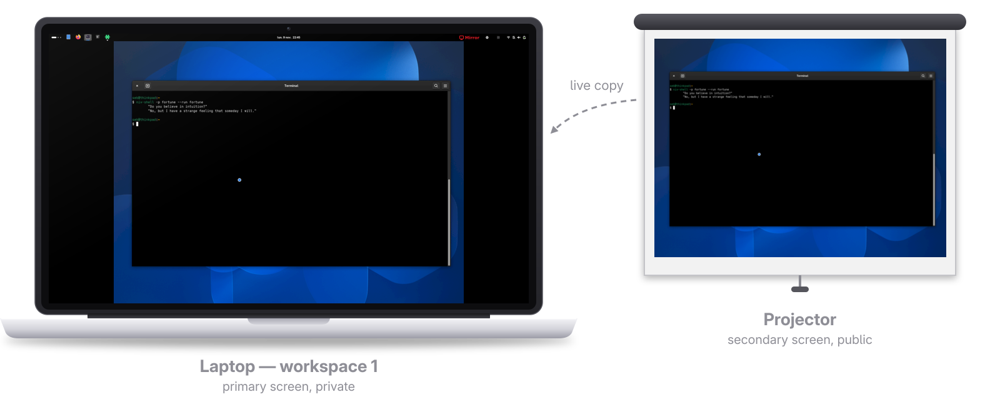

<div align="center">

# 📽️ Presentation workspace

**Project workspace 1. Keep the others private.**

*For anyone who projects their screen, to present or to teach. A GNOME Shell extension
that completes extended mode and makes it feel like GNOME projects a single workspace.*

[](https://github.com/essembeh/gnome-presentation-workspace/actions/workflows/build.yml)
[](https://release.gnome.org/)
[](LICENSE)

</div>

---

You give a talk or teach a class, with your laptop connected to a projector or a large
screen. GNOME offers two modes, and neither is quite right:

- **Mirror** shows the room everything: your notes, your mail, your notifications.
- **Extended** keeps your screen private, but the projected screen is **behind you**.
  You turn around to see it, or run an OBS projector window just to know what you are
  showing.

This extension completes **extended mode**. The extended screen is what you project,
and it is mirrored live on **workspace 1** of your own screen. It feels as if GNOME
projected workspace 1 only, and workspaces 2, 3… are yours alone.



**Designed to be seamless.** You should not have to think about having two screens:

- **Smart pointer.** Swipe to workspace 1 and the pointer is on the projected screen, at
  the spot you see it. Swipe away and it comes back with you. Push the top edge to reach
  your top bar.
- **Smart windows.** Open a window on workspace 1 and the room sees it. Alt+Tab there
  lists what is projected. Leave workspace 1 and your keyboard leaves projected windows,
  so what you type next stays private.

The room keeps seeing the projected screen while you work on a private workspace: your
slides stay up while you read your notes.

## What it does

- 📽️ **One button in Quick Settings**, next to Wi-Fi and Do Not Disturb, with the
  preferences one click away. While presenting, a top bar button shows a red **Mirror**
  on workspace 1 and a green **Private** on the others; otherwise the extension adds
  nothing there. Private is about the workspace you are on: the room still sees the
  secondary screen. The mode is off at every login and turns on in one click.
- 🖼️ **Picture-in-picture on private workspaces.** From the Mirror/Private menu, keep a
  small live copy of the secondary screen in a corner, clear of the top bar. Drag it to
  another corner, double-click it to go to workspace 1.
- 🪞 **Workspace 1 is the room's view.** A live copy of the secondary screen, scaled
  to fit with black bands, drawn under your top bar. Leave workspace 1 and it is
  gone; come back and it is there. It is a compositor clone, not a video capture:
  no lag, no encoding, near-zero cost.
- 🔴 **You see the pointer.** A dot marks where the pointer is on the secondary
  screen — on a scaled-down copy, a real arrow would be lost.
- 👆 **Swipe from anywhere.** The trackpad gesture switches workspaces even with the
  pointer on the secondary screen, the copy slides with workspace 1, and the pointer and
  keyboard come back with you.
- 🔭 **The overview shows it too.** In the overview, workspace 1 lists the projected
  windows instead of looking empty, and the pointer stays where you can see it; click a
  window to go back to it.
- 🧹 **Workspace 1 holds nothing else.** Turn the mode on with windows already there:
  an empty workspace is inserted in front of them and becomes workspace 1. Your
  windows slide one workspace to the right, untouched.
- 🎞️ **Fullscreen slides keep moving.** A fullscreen window on the secondary screen
  normally bypasses the compositor and would freeze the copy; not while presenting.
- ⌨️ **`Super+E` shares the focused window** — sends it to the secondary screen and
  follows it to workspace 1, or brings it back to the workspace it came from. The key
  can be changed.
- ⬆️ **Push the top edge to reach the top bar.** On workspace 1, push the pointer
  against the top of the secondary screen: it lands on your top bar, right above its
  place in the copy. Go back down and it returns to the secondary screen.
- 🔀 **Alt+Tab follows workspace 1.** On workspace 1 it lists the windows the room
  sees, not your private ones; from a private workspace, picking a projected window
  takes you back to workspace 1.
- 🔕 **Do Not Disturb while presenting**, and your previous setting back afterwards —
  even if GNOME Shell crashes in between.

## Menu and preferences

The **Presentation** button sits in GNOME's Quick Settings menu, top right. Click it to
turn the mode on or off (greyed out without a secondary screen); its arrow opens a
menu with **Preferences**. While presenting, the **Mirror/Private** button in the top
bar opens a menu with **Picture-in-picture** and **Preferences**. The preferences
window also opens from GNOME's Extensions app, like any extension's.
Two switches group the smart behaviors, so either can go back to plain GNOME. Options
apply right away, even with the mode on.

<p align="center"></p>

| Option                          | Default   |
| ------------------------------- | --------- |
| Smart pointer                   | on        |
| Smart windows                   | on        |
| Do Not Disturb while presenting | on        |
| Red border around the mirror    | on        |
| Share window shortcut           | `Super+E` |

With both smart options off, the mode is the live copy on workspace 1 and its top bar
indicator, plus the shortcut and Do Not Disturb.

**Red border around the mirror** — a thin red frame around the projected image on
workspace 1 and around the picture-in-picture, to make the shared area stand out. Only
you see it, never the room.

**Picture-in-picture** (top bar menu) — 20 % of the screen width. Dropped anywhere, it
snaps to the nearest corner. Its switch and its corner are kept between sessions.

**Smart pointer** — moving from one screen to the other means dragging the pointer
across the edge. With this on:

- Arriving on workspace 1 puts the pointer on the secondary screen, at the spot it was
  over in the copy. Leaving brings it back to that spot on the primary screen, only if
  it was still on the secondary one. Switching between private workspaces never moves it.
- The trackpad swipe switches workspaces from the secondary screen too.
- The overview keeps the pointer on the primary screen, where you can see it, until it
  closes.
- Pushing against the top edge of the secondary screen (a push like GNOME's hot corner,
  not a touch: tabs and slide toolbars up there still work) jumps to the top bar, above
  the pointer's place in the copy. Leaving the top bar downward goes back to the same
  column, unless you opened a top bar menu in between.

**Smart windows** — workspace 1 *shows* the public screen. With this on:

- A window opened on workspace 1 lands on the secondary screen instead of hiding under
  the copy. Windows that were there before the mode turned on are never shown to the
  room: they moved to workspace 2.
- On workspace 1, Alt+Tab lists only the windows the room sees, through GNOME's own
  *current workspace only* switch; your setting is back when you leave. From a private
  workspace, Alt+Tab to a projected window goes back to workspace 1. Only Alt+Tab does
  this: clicking the projected slides from your notes workspace leaves you there.
- Leaving workspace 1 takes the keyboard off a projected window, so what you type next
  stays private.

**The shortcut** — `Super+E` on a window of the primary screen sends it to the
secondary screen and, while presenting with Smart windows on, follows it to workspace
1. On a window of the secondary screen, it brings it back to the workspace it came from
and switches there (never to workspace 1 while presenting). It works whether the mode
is on or not. GNOME already has `Super+Shift+←/→`; this one needs no
thinking about which side the screen is on. To change the key, click its row in the
preferences and press the new combination (Backspace restores `Super+E`).

## Which screen is which

The extension assumes nothing about your hardware. The **private** screen is the one
GNOME calls **primary** (Settings › Displays › Primary Display); the **public** one is
the first other screen. Laptop + projector is the usual case, but a desktop with two
monitors works the same way.

## What it deliberately does NOT do

No clicking through the copy: it is read-only, the room's screen is driven from the
room's screen. No third screen. No resolution switching — GNOME's Settings › Displays
does it already. No presenter timer, no laser pointer, no annotations.

Small code, few settings: see [the spec](docs/specs/features.md) (in French) — §0
(KISS) is the project's constitution, §3 lists what stays out.

## Requirements

| Setting                                       | Expected                                    |
| --------------------------------------------- | ------------------------------------------- |
| GNOME Shell                                   | 50                                          |
| Settings › Displays › Multiple Displays       | **Join** (extended), not Mirror             |
| Settings › Displays › Primary Display         | your **private** screen                     |
| `org.gnome.mutter workspaces-only-on-primary` | `true` (the default)                        |
| Settings › Multitasking › Workspaces          | **dynamic** (to insert the empty workspace) |

With `workspaces-only-on-primary` off, the secondary screen changes with the
workspace and the whole idea falls apart. With fixed workspaces everything works,
except that windows already on workspace 1 stay hidden under the copy instead of
moving to workspace 2.

## Install

### From a release

```bash
curl -L -o /tmp/presentation-workspace.zip \
  "https://github.com/essembeh/gnome-presentation-workspace/releases/latest/download/presentation-workspace@essembeh.org.shell-extension.zip"
gnome-extensions install --force /tmp/presentation-workspace.zip
```

Log out and back in (Wayland gives no other way to load new extension code), then:

```bash
gnome-extensions enable presentation-workspace@essembeh.org
```

### From source

```bash
git clone https://github.com/essembeh/gnome-presentation-workspace.git
cd gnome-presentation-workspace
just install    # checks, builds the zip, installs it
```

Then log out and back in, and enable it as above.

## Hacking

Dev tools come from [`shell.nix`](shell.nix) (`node`, `glib-compile-schemas`, `zip`,
`just`), loaded automatically by direnv (`direnv allow` once).

```bash
just            # list the recipes
just check      # what the CI runs: syntax, unit tests, markdown tables, schema
just install    # build the zip and install it in your session
```

There is no nested shell: a nested GNOME Shell cannot display two monitors, so the
extension is tested in a real session with a real second screen. Pure logic
(letterboxing, pointer and workspace decisions) lives in `src/geometry.js`, free of
`gi://` imports, and is unit-tested under node.

## License

[GPL-3.0](LICENSE) — same as GNOME Shell itself.
